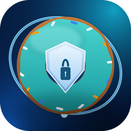
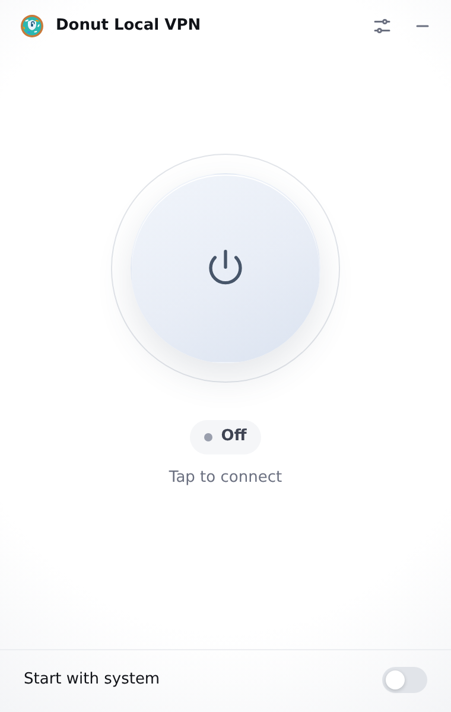
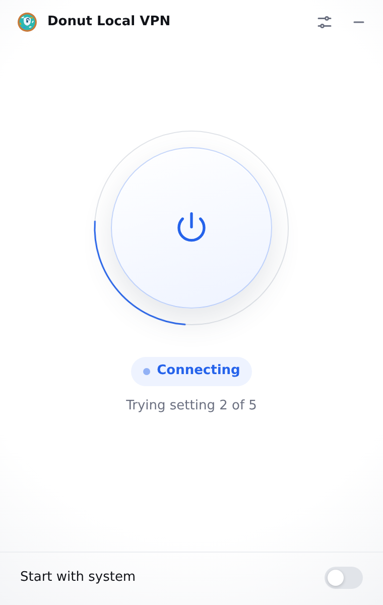
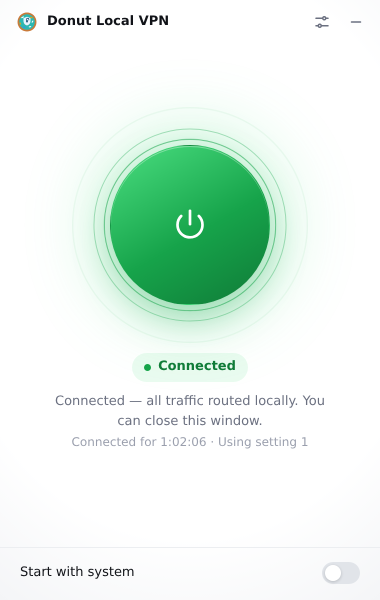
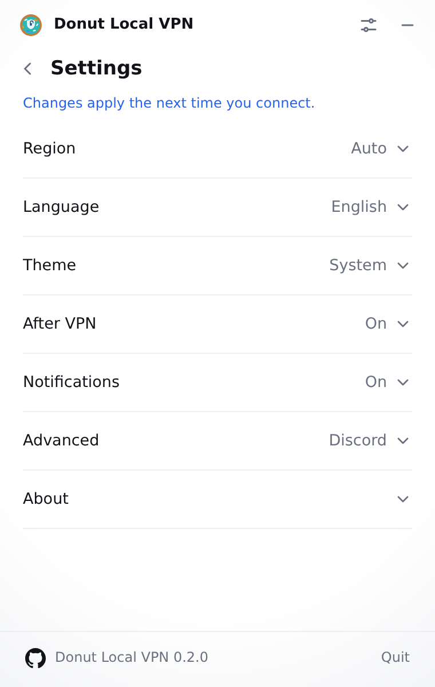

<p align="center">
  
</p>

<h1 align="center">Donut Local VPN</h1>

<p align="center">
  One click. A local tunnel for every app.<br />
  Opens the sites your provider blocks — Discord, YouTube and the rest — without an account and without a remote server.
</p>

<p align="center">
  <a href="https://github.com/bobthebuilder1234232243/Donut-Local-VPN-B/releases/latest"></a>
  
  <a href="LICENSE"></a>
</p>

<p align="center">
  
  
  
</p>

---

## What it does

Some internet providers inspect the first packet of a connection and block it when they recognise a site they do not like. The DPI bypass engine in Donut Local VPN changes that first packet — it splits it, reorders it or adjusts its TTL — so the filter no longer recognises the connection and lets it through.

Donut Local VPN tries a catalogue of known-good settings, checks them against real sites, keeps the first one that works and then watches the connection. When the network changes, the connection breaks or you reconnect to a VPN, it tests again and switches setting on its own.

Thousands of people used the original FreeDPI for this. Donut Local VPN is the same engine with a new name, a new identity and, on macOS and Linux, a real local tunnel instead of a system proxy.

## What "local VPN" means

A VPN normally sends your traffic to a server in another country. Donut Local VPN does not.

- **No remote server.** Packets end up at the site you asked for, not at a machine of ours.
- **No added encryption.** Your traffic is protected exactly as much as the site's own HTTPS protects it — no more.
- **Your IP address stays visible.** This does not hide your location and is not an anonymity tool.
- **Local** refers to the virtual network interface on your own computer. On macOS and Linux all traffic is routed into it, which is why every app is covered without configuring a proxy.

If you need a different IP address or encryption to a remote server, use a real VPN. Donut Local VPN solves blocked sites, not anonymity.

## Screenshots

| Connected | Settings |
| --- | --- |
|  |  |

## Supported platforms

| Platform | Versions | What runs |
| --- | --- | --- |
| Windows | 10 and 11, 64-bit | WinDivert driver + GoodbyeDPI engine |
| macOS | 11 Big Sur or newer, Intel and Apple Silicon | `utun` TUN interface + built-in engine |
| Linux | 64-bit, `.deb` or AppImage | `/dev/net/tun` + built-in engine |

Windows behaviour is unchanged from FreeDPI: the driver filters packets for every app and needs administrator rights when the app starts.

On macOS and Linux the app creates a TUN interface owned by a short-lived helper process, sets it as the default route for the duration of the connection and runs the same bypass engine behind it:

```
app → utun / tun0 → local TCP stack → bypass engine → physical interface → site
```

With the DPI bypass on (the default), DNS queries that arrive on the tunnel are answered over HTTPS, so the resolver your provider gave you is not used while you are connected. With the bypass off, queries are forwarded unchanged to your system resolver instead.

**Limitation on macOS and Linux:** the tunnel carries TCP and DNS (UDP port 53). Other UDP traffic — QUIC, some games and some voice chat — and ICMP are not tunnelled; browsers and most apps fall back to TCP automatically. Windows is not affected because it filters at the driver level.

## Download

Grab the file for your platform from [the latest release](https://github.com/bobthebuilder1234232243/Donut-Local-VPN-B/releases/latest):

| Platform | File |
| --- | --- |
| Windows | `Donut-Local-VPN_0.2.0_x64-setup.exe` |
| macOS (universal) | `Donut-Local-VPN_0.2.0_universal.dmg` |
| Linux (AppImage) | `Donut-Local-VPN_0.2.0_amd64.AppImage` |
| Linux (Debian/Ubuntu) | `Donut-Local-VPN_0.2.0_amd64.deb` |

The updater downloads `Donut-Local-VPN_universal.app.tar.gz` on macOS and the normal installer on Windows and Linux; you do not need to pick those files by hand.

The builds are not code-signed with an Apple Developer ID or a Windows EV certificate. On macOS, open the `.dmg`, drag the app to Applications and, if Gatekeeper complains, right-click the app and choose **Open** once. On Windows, SmartScreen may ask you to confirm the publisher.

## Permissions

Creating a tunnel and changing the routing table is a privileged operation on every system.

- **Windows** — the app asks for administrator rights when it starts, because the WinDivert driver needs them.
- **macOS** — you are asked for your administrator password each time you connect. The helper runs as root only while the tunnel is up; when you disconnect, it exits and the original routes and DNS settings are restored. If the app crashes, the helper notices that its control connection is gone and restores the system by itself.
- **Linux** — the helper is started through `pkexec` (the desktop password prompt) or `sudo`. The app itself stays unprivileged. You need root or `CAP_NET_ADMIN`.

There is no background root service, no launch daemon and no permanent change to your network configuration.

## Using it

1. Start Donut Local VPN.
2. Press **Connect**.
3. The app tries a setting, checks it against the test sites, and either keeps it or moves on. When it says **Connected — all traffic routed locally**, you can close the window; the app keeps running in the tray.

The tray icon shows the state: grey when off, teal when connected, amber while searching, red when the last attempt failed. The tray menu can connect, disconnect, open the window or quit.

On macOS and Linux the connection is a real tunnel, so there is no proxy address to copy and no per-app configuration. On Windows the driver covers every app the same way.

### Session details

While connected, the main screen shows the live session: the tunnel address, the device address,
whether the DPI bypass is on, how long the session has been up, and the bytes sent and received.
The values are read from the running engine once a second — the panel does not estimate or cache
them. It is hidden while disconnected.

### Self-healing

While connected, the app checks the connection periodically. When it breaks — a VPN connects, Wi-Fi changes, the laptop wakes from sleep — it searches for a working setting again. With **Reconnect after network change** on (the default), it waits for the interfering VPN or network change to go away and then reconnects on its own.

## Settings

| Setting | What it does |
| --- | --- |
| **Region** | Picks which settings are tried first. **Auto** works everywhere. |
| **Test sites** | The domains used to decide whether a setting works. The app works for every site; these are only the test targets. |
| **Only test sites** | Applies the bypass only to the listed domains and leaves everything else untouched. Blocked sites that are not listed will not open. |
| **Start with system** | Starts minimised in the tray when you log in. On Linux this writes `~/.config/autostart/donut-local-vpn.desktop`. |
| **Connect on launch** | Connects as soon as the app starts, including when it started at login. Separate from **Start with system**, so you can launch it without connecting immediately. |
| **DPI bypass** | On keeps TLS splitting and DNS over HTTPS. Off passes traffic through unchanged and uses the system DNS. The Windows driver always runs the bypass and cannot turn it off. |
| **Tunnel IP / Device IP** | Advanced network addresses for the local tunnel (IPv4, the tunnel address may include a prefix such as `/24`). Validated before saving and applied on the next connection. There is no remote server address — the tunnel is local. |
| **Reconnect after network change** | Reconnects after another VPN or a network change breaks the connection. |
| **Connection logs** | Scrolling engine log with an info/warning/error filter and a copy button. Entries are also written to the log file. |
| **Notifications** | Tells you when the app connects, disconnects or switches setting. |
| **Theme** | System, light or dark. |
| **Language** | English, Türkçe, Русский, Español, Italiano, Polski, 한국어, 繁體中文 or Français. The app and the tray menu follow; the system locale is detected on first start and English is the fallback. |
| **Advanced → Help** | Copies diagnostics for a bug report. |

## Updates

Donut Local VPN checks `https://github.com/bobthebuilder1234232243/Donut-Local-VPN-B/releases/latest/download/latest.json` every 30 minutes and whenever the window opens. Updates are signed with the project's own Tauri key and installed in place.

> **Coming from FreeDPI?** You cannot auto-update from FreeDPI to Donut Local VPN. The original releases were signed with a different key, so the updater rejects them by design. Download 0.2.0 from the releases page and install it over your copy; your saved settings are imported automatically from the old `com.freedpi.desktop` configuration directory. After that, updates work normally.

## Troubleshooting

**No setting worked.** Check that the sites really are blocked and that the connection works without the app. Some networks block by IP address or DNS rather than by inspecting packets, and no client-side trick can get around that. Try another region setting, then another network.

**Kaspersky is installed.** Kaspersky's network filter interferes with the driver and with the tunnel. Remove it or exclude the app; the app cannot work reliably next to it.

**macOS says the app is damaged or from an unidentified developer.** The build is unsigned. Right-click the app in Finder, choose **Open**, then confirm. If macOS still refuses: `xattr -dr com.apple.quarantine "/Applications/Donut Local VPN.app"`.

**Linux: no tray icon.** Install `libayatana-appindicator3-1` (the `.deb` depends on it) and make sure your desktop has an AppIndicator extension.

**Linux: the password prompt does not appear.** Run the app from a terminal; it falls back to `sudo` and prints the error there. Without a Polkit agent, `pkexec` cannot ask for a password.

**A game or voice chat does not connect.** On macOS and Linux only TCP and DNS go through the tunnel. UDP-based traffic takes the normal route, which may still be blocked.

**The connection drops after waking up.** Leave **Reconnect after VPN** on; the app tests the network again after a wake-up or a network change.

**Something else.** Open **Settings → Advanced → Help**, press **Copy diagnostics**, and attach the text to a [new issue](https://github.com/bobthebuilder1234232243/Donut-Local-VPN-B/issues/new). Logs are written to the app log directory: `~/Library/Logs/com.donutvpn.donutlocalvpn` on macOS, `~/.local/share/com.donutvpn.donutlocalvpn/logs` on Linux and `%LOCALAPPDATA%\com.donutvpn.donutlocalvpn\logs` on Windows.

## Privacy

- No account, no sign-up, no telemetry and no analytics.
- The app contacts the test domains you selected (Discord, YouTube, Roblox, Wattpad, or your own), a DNS-over-HTTPS resolver for lookups inside the tunnel, and GitHub for update checks.
- Diagnostics contain the app version, the current state and recent log lines. They are never uploaded automatically.
- Traffic content is never inspected, stored or sent anywhere by the app.

## Build from source

Requirements: Node.js 20+, Rust 1.77+, and the [Tauri 2 prerequisites](https://v2.tauri.app/start/prerequisites/) for your platform (on Linux: `libwebkit2gtk-4.1-dev`, `libappindicator3-dev`, `librsvg2-dev`, `patchelf`).

```bash
npm ci

npm run tauri dev                    # development window with hot reload
npm run tauri build                  # installers in src-tauri/target/release/bundle

cd src-tauri && cargo test           # app tests (needs the Tauri/GTK system libraries)
cd src-tauri/tunnel-harness && cargo test --lib   # engine, tunnel and DNS tests, no GUI stack
```

The privileged end-to-end test creates a real TUN interface, installs the split
default routes, sends DNS and TCP through the tunnel and checks the teardown. It
needs root, `NET_ADMIN` and `/dev/net/tun`, so run it in the container used by CI:

```bash
docker build -f .github/tunnel-test/Dockerfile -t donut-tunnel-test .
docker run --rm --cap-add=NET_ADMIN --device=/dev/net/tun donut-tunnel-test

# the same test with the DPI bypass off
docker run --rm --cap-add=NET_ADMIN --device=/dev/net/tun \
  -e DONUT_TEST_DPI=0 donut-tunnel-test
```

`.github/workflows/test-tunnel.yml` runs both modes on every push and pull request. The
release workflow calls it and depends on it, so installers are only built when the
tunnel test is green.

To produce signed updater artifacts, set `TAURI_SIGNING_PRIVATE_KEY` and `TAURI_SIGNING_PRIVATE_KEY_PASSWORD` before building. The public key lives in `src-tauri/tauri.conf.json`; the private key is never committed.

### Project layout

```
src/                     UI (TypeScript, no framework)
src-tauri/src/engine/    DPI bypass engine and proxy
src-tauri/src/engine/tunnel/   TUN interface, userspace TCP stack, DNS, routes, privileged helper
src-tauri/src/           app lifecycle, tray, updater, settings
src-tauri/tunnel-harness/  build/test the engine without the GUI stack, plus the privileged TUN test
src-tauri/resources/     GoodbyeDPI and WinDivert binaries (Windows)
third_party/             third-party notices
.github/tunnel-test/     container image for the privileged TUN integration test
.github/workflows/       release build, signing, update manifest and tunnel test
```

## Credits

Donut Local VPN — by Donut VPN. Originally based on FreeDPI by hasanerman.

- Original project: [hasanerman/FreeDPI](https://github.com/hasanerman/FreeDPI)
- DPI bypass engine: GoodbyeDPI and WinDivert, see [third_party/](third_party/)
- Tunnel stack: [`tun`](https://crates.io/crates/tun) and [`smoltcp`](https://crates.io/crates/smoltcp)

About screen text:

> Donut Local VPN — By Donut VPN — https://techperson1234.github.io/Donut-VPN/ — Based on FreeDPI by hasanerman (https://github.com/hasanerman/FreeDPI).

## Disclaimer

Use this only where bypassing network filtering is legal. It does not hide your IP address, does not encrypt your traffic and is not a substitute for a VPN when you need privacy or a different location. The authors are not responsible for how you use it.

## License

GPL-3.0. See [LICENSE](LICENSE). The licence and the contents of `third_party/` are unchanged from FreeDPI.
